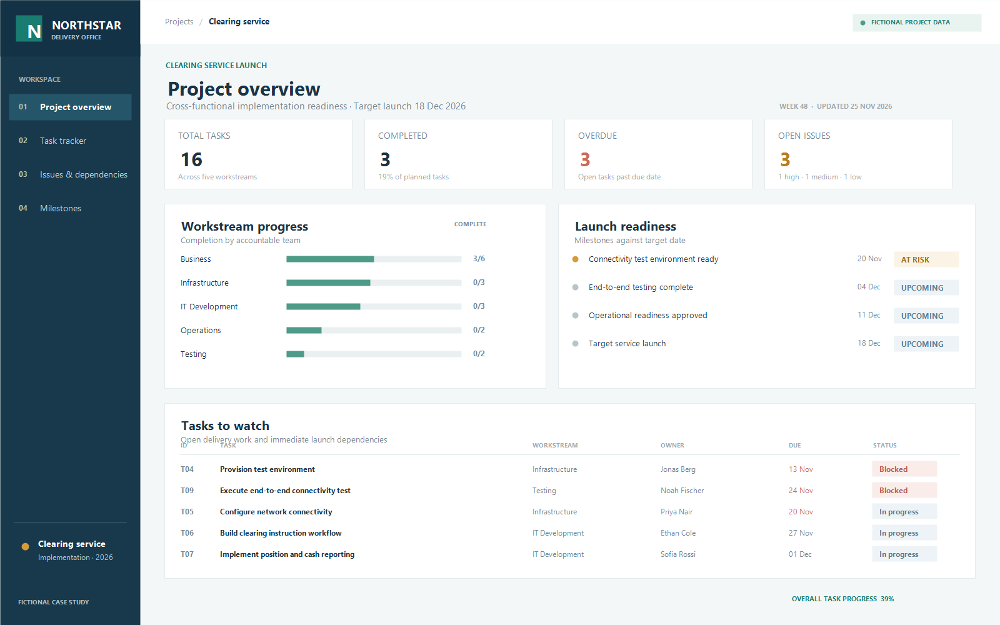

# Clearing Service Implementation Tracker

A fictional, recruiter-facing project case study showing how a project coordinator can turn implementation updates from business, development, testing, infrastructure and operations into a clear delivery view.

**Business question:** Can the team launch the new clearing service on 18 December 2026, and what needs management attention this week?

> All names, dates, work items, statuses and risks are fictional. This project contains no Deutsche Börse or client data and does not describe a real launch.

## The business problem

Project updates often arrive in separate spreadsheets and conversations. A coordinator has to reconcile who owns each action, which work is late, what it depends on, and whether issues threaten a launch checkpoint. Without a shared view, management may hear about a blocked test too late to protect the certification window.

## The solution

This small implementation tracker combines four related data tables: **Project Tasks**, **Dependencies**, **Issues**, and **Milestones**. A lightweight web dashboard summarizes delivery status, allows task search and filtering, surfaces open issues and milestones, and exports the task list as CSV. The same source data can be opened in Excel, imported into Power BI, or queried using the included SQL examples.

### Power BI dashboard images

The three report-page images are ready to view directly in GitHub; no local server is needed. They use the same fictional project snapshot and cover the requested management views.

**Project overview**



**Issues & dependencies** · [Open image](powerbi-dashboards/02-issues-and-dependencies.png)

**Milestone tracking** · [Open image](powerbi-dashboards/03-milestone-tracking.png)

The PNG files are in [`powerbi-dashboards/`](powerbi-dashboards/), with a reproducible renderer at `scripts/render_dashboard_images.ps1`. The existing `index.html` is an optional interactive companion; see the local run instructions below only if you want that version.

## Example results (as of 25 November 2026)

- **16 tasks** across five workstreams; **3 complete**.
- **3 open tasks are overdue**, including the test environment and connectivity path.
- **3 open issues**, including one high-severity infrastructure issue.
- The primary schedule risk is an unstable test environment, delaying end-to-end connectivity testing and putting the certification window at risk.
- The recommended management action is for Infrastructure to stabilise and confirm the environment by 27 November, with Testing to re-plan the certification run immediately after sign-off.

These are calculated from the fictional snapshot, not claims about a real project. Overall task completion counts tasks marked Complete; workstream bars show average task progress.

## Run it locally

1. Install Python 3 (no third-party packages are needed).
2. From the project folder, run `python -m http.server 8000`.
3. Open [http://localhost:8000](http://localhost:8000).

The dashboard fetches `data/project.json`, so it needs to be served over HTTP rather than opened as a `file://` page. Select **Export tasks** to download a task CSV.

## Excel workbook

Run `python scripts/build_workbook.py` to create `data/clearing_service_tracker.xlsx` and four Excel-friendly CSV files in `data/exports/`. The workbook contains four sheets: Project Tasks, Dependencies, Issues, and Milestones. It uses only Python's standard library.

## Power BI implementation steps

1. Import the four workbook sheets (or the four CSV exports) into Power BI Desktop.
2. Set the ID fields to text, progress to a whole number, and planned/due/actual dates to date. Keep a blank actual milestone date as null.
3. Relate `Project Tasks[Task ID]` to `Dependencies[Task ID]`, `Issues[Issue ID]` only if needed for issue detail, and use `Dependencies[Depends On Task ID]` as a second, inactive relationship to Project Tasks. Relate milestones independently; do not join issue rows directly to tasks because that can multiply task counts.
4. Create measures from `sql/queries.sql` or equivalent DAX. Build three report pages: Project Overview, Issues & Dependencies, and Milestone Tracking.
5. Use a consistent “as of” date when calculating overdue work. Confirm the dashboard figures against the weekly status report before sharing.

## SQL implementation steps

`sql/schema.sql` defines portable relational tables and keys. Load the workbook or CSV exports into those tables, then use `sql/queries.sql` to answer common coordination questions: overdue tasks, progress by team, open issues, and tasks waiting on an unfinished dependency.

## Weekly management update

The one-page report is in [`reports/weekly_status_2026-11-25.md`](reports/weekly_status_2026-11-25.md). It states the schedule risk, business impact, accountable team and action requested, so the data leads to a decision rather than stopping at a chart.

## Repository map

```text
index.html                 Interactive dashboard
styles.css                 Responsive visual design
app.js                     Filtering, rendering and CSV export
data/project.json          Single fictional source of truth
scripts/build_workbook.py  Creates the four-sheet Excel workbook and CSV exports
sql/schema.sql             Table definitions and keys
sql/queries.sql            Example project-control queries
reports/                   One-page weekly management update
```

## GitHub

This folder is structured as a standalone Git repository. To publish it, create an empty repository on GitHub, then run:

```bash
git init
git add .
git commit -m "Build clearing service implementation tracker"
git branch -M main
git remote add origin https://github.com/<your-username>/clearing-service-tracker.git
git push -u origin main
```

Replace `<your-username>` with your GitHub username. The dashboard can also be hosted with GitHub Pages from the repository root.

## Scope and limitations

This is a beginner-friendly portfolio case study, not a production project-management or clearing platform. It uses a single static snapshot, manual status updates, and illustrative assumptions. The dashboard's task and issue counts are derived from the JSON file at page load; it does not include authentication, live integrations, automated critical-path scheduling, or real clearing workflows.
