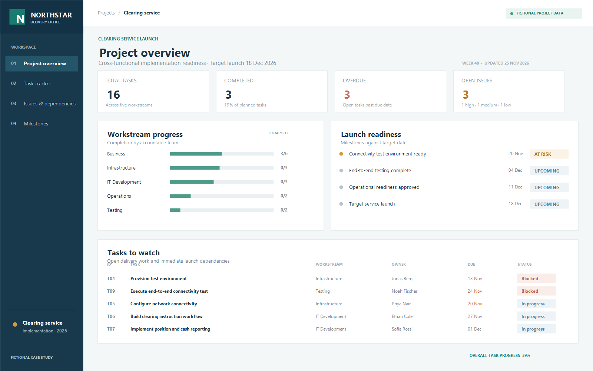
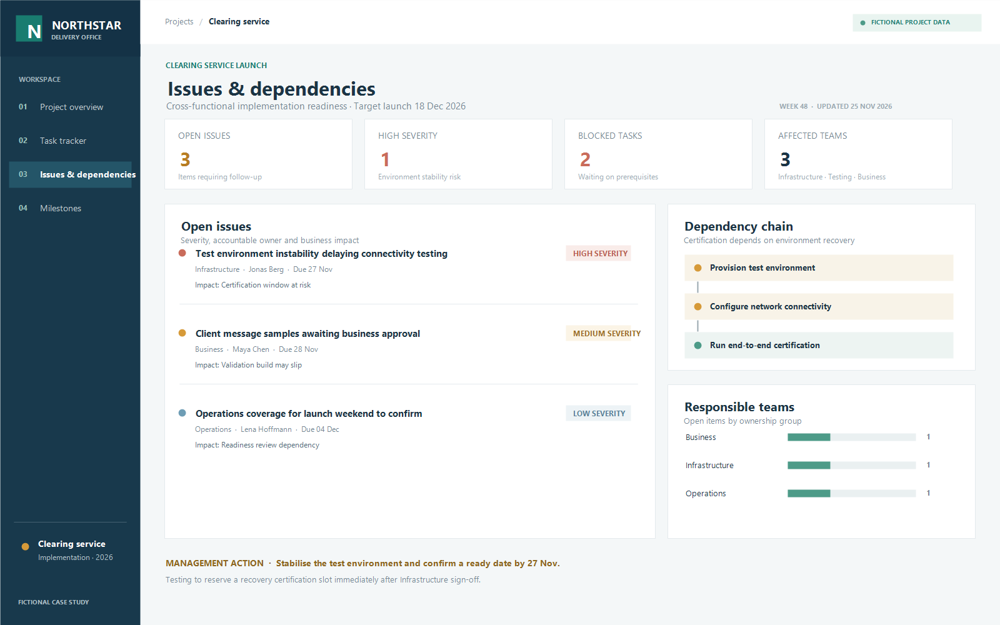
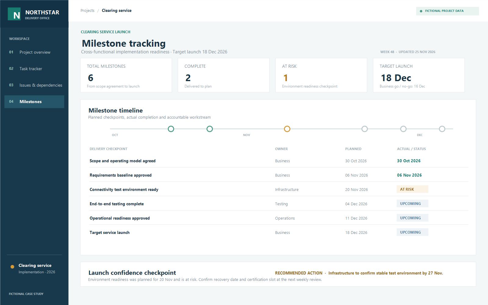

.

## Project overview

## Issues and dependencies

## Milestone tracking

To regenerate the images from `data/project.json`, run `pwsh -NoProfile -File scripts/render_dashboard_images.ps1` from the repository root on Windows. These are static report-page images, not an interactive `.pbix` file.
